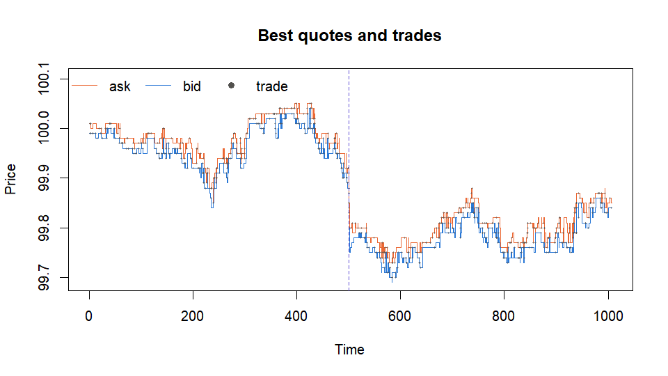
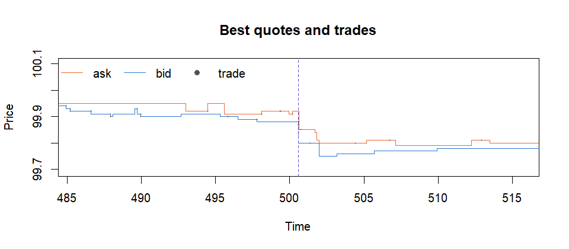
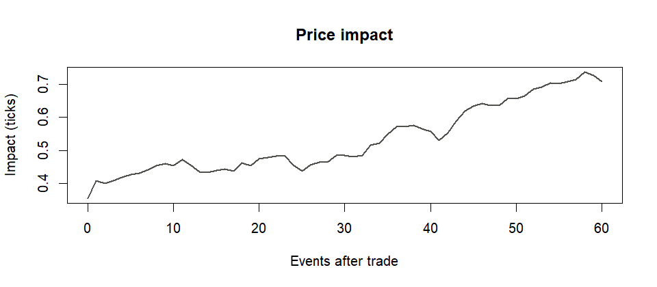
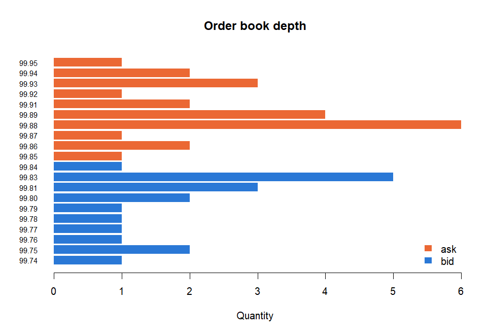

<!-- README.md is generated from README.Rmd. Please edit that file -->

# orderBookSim

<!-- badges: start -->

[](https://github.com/adebayomoses/orderBookSim/actions/workflows/R-CMD-check.yaml)
[](https://app.codecov.io/gh/adebayomoses/orderBookSim)
<!-- badges: end -->

Agent-based limit order book simulation for teaching and researching
market microstructure in R.

`orderBookSim` gives you:

- **A matching engine.** A continuous double auction with price-time
  priority, limit, market and cancel orders (`lob_new()`,
  `lob_submit()`, `lob_cancel()`).
- **Trading agents.** Zero-intelligence order flow (Smith et al. 2003),
  noise traders, inventory-constrained market makers, momentum traders
  and informed traders (`agent_*()`).
- **An event-driven simulator.** Continuous-time Poisson arrivals,
  reproducible seeds and injectable liquidity shocks (`simulate_lob()`).
- **Liquidity measures.** Time-weighted spreads and depth, price impact
  by lag and size, resilience after shocks, and stylised facts of
  returns.
- **An interactive app.** A ‘shiny’ explorer for the classroom
  (`run_lob_app()`).

## Installation

``` r
# install.packages("remotes")
remotes::install_github("adebayomoses/orderBookSim")
```

## Example

Simulate a market with zero-intelligence order flow, a market maker and
an informed trader, and hit it with a large sell order halfway through.

``` r
library(orderBookSim)

agents <- list(
  agent_zi(limit_rate = 2, market_rate = 0.4, cancel_rate = 0.05),
  agent_market_maker(half_spread = 2),
  agent_informed(rate = 0.2)
)

sim <- simulate_lob(agents, n_events = 5000, seed = 1,
                    shocks = data.frame(event = 2500, side = "sell", qty = 40))
summary(sim)
#> Limit order book simulation
#>   events / duration            5000 / 1007
#>   trades / volume              669 / 694
#>   mean spread (time-weighted)  0.0245 (2.45 ticks)
#>   median spread                2.0 ticks
#>   mean best bid / ask size     2.67 / 2.89
#>   time with one-sided book     0.0%
#>   realised volatility          0.00008
#>   mid price                    100.00 -> 99.84
```

Best quotes and trades over time; the dashed line marks the shock:

``` r
plot(sim)
```



The shock wanted to sell 40 units, but the bids in the book added up to
only 13, so it swept every one of them and the rest went unfilled. The
market maker requoted at the very next event, 8 ticks lower, and the
price stayed down. Zooming in on the shock:

``` r
shock_time <- sim$quotes$time[2500]
plot(sim, xlim = shock_time + c(-15, 15))
```



``` r
resilience(sim)
#>   event side qty filled pre_spread_ticks peak_spread_ticks events_to_recover
#> 1  2500 sell  40     13            2.495               Inf                11
#>   time_to_recover mid_change_ticks
#> 1        1.232718              -13
```

Aggressive orders move the price in their direction. Here the move keeps
building for several events afterwards, because the informed trader’s
orders anticipate where the price is heading:

``` r
plot(price_impact(sim, lags = 0:60))
```



The final state of the book:

``` r
plot(sim, type = "depth")
```



## Comparing market designs

`compare_scenarios()` runs several agent mixes with the same seed, so
the differences come from the agents rather than from luck:

``` r
zi <- agent_zi(limit_rate = 0.8, market_rate = 0.4, cancel_rate = 0.05)
compare_scenarios(
  list(zi_only = list(zi),
       with_mm = list(zi, agent_market_maker(half_spread = 1))),
  n_events = 3000, seed = 2
)
#>   scenario trades volume mean_spread_ticks mean_bid_size mean_ask_size
#> 1  zi_only    671    671          4.130293      1.355182      1.320840
#> 2  with_mm    421    421          2.431865      4.622649      4.969603
#>   one_sided_share realised_vol
#> 1      0.07241381 0.0001768412
#> 2      0.00000000 0.0000505363
```

See `vignette("orderBookSim")` for a guided tour, including stylised
facts and the interactive app.

## Performance

The engine is written in plain R and handles about 10,000 events per
second on a laptop, which is enough for teaching and exploratory
research. The engine’s internals are kept in a few small functions
(`book_*()`) so that they can be moved to C++ later without changing the
user-facing API.

## Reference

Smith, E., Farmer, J. D., Gillemot, L. and Krishnamurthy, S. (2003).
Statistical theory of the continuous double auction. *Quantitative
Finance*, 3(6), 481–514. <https://doi.org/10.1088/1469-7688/3/6/307>
